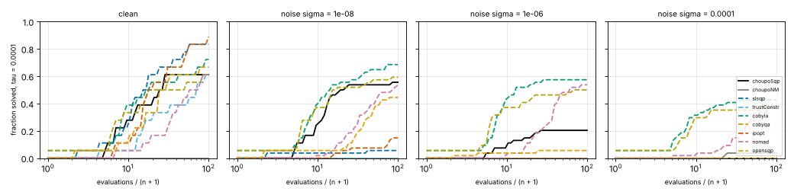
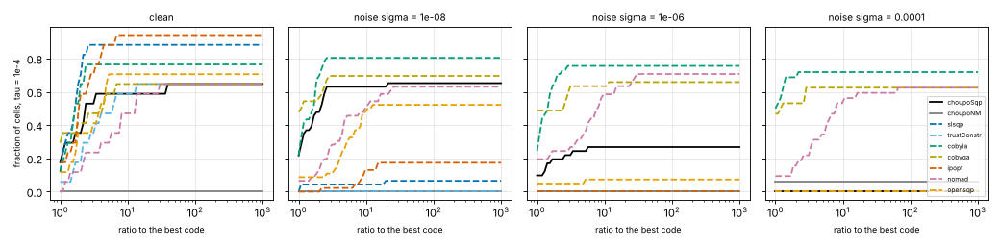
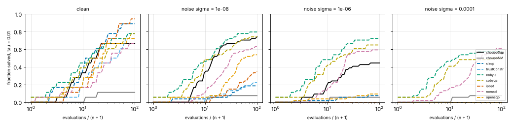
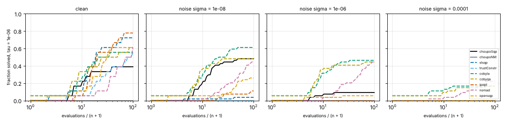

# Optimizer benchmark: results (2026-11-24, DEV.md 4c C496)

A measurement of Choupo's `sqp` and `nelderMead` against open-source codes, taken
under `docs/audits/2026-11-24-optimizer-bench-protocol.md` (protocol committed
before any result; amendments A1 and A2 also before any result the report
reads).  The driver is `bin/curate/optimizer_bench.py` (a measurement tool, not
a gate); the external packages live in a throw-away virtual environment.  Tree:
branch `optimizer-bench` on the development line, built with `make all`.
Figures: `docs/audits/optimizer-bench/`.

## 1. Headlines

* **No winner.**  Under the protocol's rule (positive against every other code,
  bootstrap interval excluding zero, larger than the seed range) no code wins in
  any condition (clean, sigma 1e-8, 1e-6, 1e-4) at any tolerance (1e-2, 1e-4,
  1e-6).  Who is ahead of whom is in the pairwise tables of section 5.
* **The four Choupo flowsheets are not noisy.**  Repeated evaluations at a point
  agree exactly (spread 0.0), and central differences with offsets down to 1e-9
  of the variable range stay within 1 % of the slope at 1e-3 range; the
  implied response noise is about 1e-13 (relative 1e-13 to 1e-12), the level of
  the solver tolerances.  The finite-difference problem that a noise-aware SQP
  is meant to solve is therefore absent from these four cases; it is present in
  the synthetic set only because noise was added there.
* **On the analytic set Choupo's `sqp` loses first to codes that do not use
  gradients, as soon as the noise is 1e-6** (section 6), and, with no noise,
  to SLSQP and IPOPT at tight tolerance.  It beats the gradient codes of SciPy,
  IPOPT and OpenSQP at sigma 1e-8 and 1e-6 only because its relative
  finite-difference step is 1e-5 against about 1.5e-8 for theirs.
* **On the flowsheets Choupo's `sqp` solves 12 of 12 cells at 1e-2 and 11 of 12
  at 1e-4** against the bench reference, in 6 to 112 simulator runs through its
  own `outerDict`; on the membrane case, which starts infeasible, only COBYLA, NOMAD, IPOPT
  and Choupo's `sqp` ever evaluate a feasible point.

## 2. Installed codes (read from the installed package metadata)

| code | version | licence (from metadata) | derivatives and step |
|---|---|---|---|
| Choupo `sqp`, `nelderMead` | tree HEAD | GPL-3.0-or-later | `sqp`: forward differences, relative step 1e-5 (the driver's default), in x/s scaling; Nelder-Mead none |
| SciPy SLSQP, trust-constr, COBYLA | scipy 1.17.1 | BSD-3-Clause | SLSQP and trust-constr: the code's own 2-point differences, relative step sqrt(eps) = 1.49e-8; COBYLA none |
| COBYQA | cobyqa 1.1.4 | BSD-3-Clause | none |
| IPOPT through cyipopt | cyipopt 1.7.0 (EPL-2.0) over the system IPOPT library 3.11.9 | EPL | forward differences supplied by the bench with SciPy's default step (this IPOPT has no internal approximation: protocol A1.1); limited-memory Hessian |
| NOMAD | PyNomadBBO 4.6.0 | LGPL-3.0 (licence file in the package; metadata field empty) | none |
| OpenSQP | `modopt` 0.4.0 installed from its repository (github.com/LSDOlab/modopt); the PyPI name `modopt` belongs to another package | LGPL-3.0-or-later | `ProblemLite` differences, step 1e-6; needs `qpsolvers` 4.13.0 (LGPL-3.0), `quadprog` 0.1.14 (GPL-2.0-or-later) and `highspy` 1.16.0 (MIT) |

Nothing failed to install.  Failures before the final installs, all fixed in the
bench's glue and not in any code: the first `cyipopt` build needed the system
BLAS/LAPACK headers; the first `modopt` from PyPI was the wrong package.
`pip install opensqp` finds no such distribution.  The Python used is 3.11.18,
numpy 2.4.6.

## 3. What was run

Set A: 18 Hock-Schittkowski problems (HS1, 7, 13, 19, 25, 31, 37, 43, 49, 55, 62,
68, 74, 80, 88, 95, 102, 110), read through the author's own Fortran collection
(Schittkowski, 306 test problems, University of Bayreuth, 2008, from
klaus-schittkowski.de; compiled unmodified; the selection rule gave 106
survivors, thinned to every sixth; HS85, 99, 105, 106 and 112 were excluded by
the source check because the collection's stored solution does not reproduce its
stored value to 1e-6 under its own code).  Each problem: one clean run, and three
noise levels (sigma 1e-8, 1e-6, 1e-4) times three seeds, for nine codes: 1620
runs, budget 100 (n + 1) evaluations on one counting function.  Of the 18, 15
are constrained and 3 are not (HS1, HS25, HS110), so the pooled profiles judge
mostly constrained behaviour; Choupo's Nelder-Mead has no constraints and counts
as unsolved on the 15.

Set B: the four flowsheets, nine codes through the wrapper (one counter), three
starts (A the tutorial start, B and C box points), budget 100; plus Choupo's two
codes through their own `outerDict`.

Run endings on set A: no errors for any code except OpenSQP, which stopped with
an internal `ValueError` ("could not broadcast ... shape (0,)", raised inside
`modopt`) on HS19, 55, 95 and 102 in 12 runs, and timed out at 180 s in 4
(HS1 three times, HS25 once); these runs count as unsolved with the evaluations
they had made.  Nothing returned a non-finite value.

## 4. Noise of the flowsheets (set B), the headline table

Measured at the tutorial start of each case: 13 offsets from 1e-3 to 1e-9 of
each variable's range, both signs, and five repeated evaluations at the point
(59 simulator runs per case, none failed).  The table gives, per response and
variable, the central slope at 1e-3, its relative change at three offsets, the
response noise estimated from the slope scatter at offsets of 1e-8 and below
(sigma = median of |slope - slope at 1e-3| x dx / 2), and the smallest offset
at which the slope stays within 1 % of the 1e-3 slope.  The full offset-by-offset
table is `docs/audits/optimizer-bench/flow_noise_full.md`.  The objective is
the one handed to the codes (rescaled, sense folded in).

| case | response | variable | slope at 1e-3 | relative slope change at 1e-5 / 1e-7 / 1e-9 | absolute response noise (sigma) | sigma / response scale | smallest offset with slope within 1 % |
|---|---|---|---|---|---|---|---|
| optim01_column_reflux | f | 0 | 0.01389 | 7.9e-08 / 8.0e-06 / 8.0e-04 | 2.2e-14 | 4.4e-13 | 1e-09 |
| optim01_column_reflux | f | 1 | 0 (no effect) | - | - | - | - |
| optim01_column_reflux | repeat spread of 5 evaluations at the point (every response) | - | - | - | 0.0e+00 | - | - |
| optim02_process_cost | f | 0 | -0.08181 | 2.8e-06 / 1.3e-04 / 1.1e-02 | 7.0e-15 | 7.0e-15 | 3e-09 |
| optim02_process_cost | f | 1 | -0.005461 | 1.1e-05 / 6.9e-06 / 1.7e-04 | 1.1e-13 | 1.1e-13 | 1e-09 |
| optim02_process_cost | repeat spread of 5 evaluations at the point (every response) | - | - | - | 0.0e+00 | - | - |
| optim04_membrane_recovery_scaling | f | 0 | -4.335e-07 | 2.8e-07 / 9.3e-07 / 8.2e-05 | 2.1e-13 | 4.0e-13 | 1e-09 |
| optim04_membrane_recovery_scaling | vessel.maxSI_gypsum_wall | 0 | -6.5e-07 | 5.7e-08 / 8.6e-07 / 3.0e-05 | 1.1e-13 | 1.5e-13 | 1e-09 |
| optim04_membrane_recovery_scaling | vessel.maxSI_calcite_wall | 0 | -8.322e-07 | 8.9e-08 / 6.0e-07 / 7.7e-05 | 2.1e-13 | 7.6e-13 | 1e-09 |
| optim04_membrane_recovery_scaling | f | 1 | -0.08537 | 1.1e-06 / 6.1e-06 / 4.4e-04 | 2.3e-13 | 4.4e-13 | 1e-09 |
| optim04_membrane_recovery_scaling | vessel.maxSI_gypsum_wall | 1 | -0.03801 | 2.2e-04 / 2.2e-04 / 1.8e-03 | 4.1e-13 | 5.6e-13 | 1e-09 |
| optim04_membrane_recovery_scaling | vessel.maxSI_calcite_wall | 1 | -0.04859 | 2.3e-04 / 2.4e-04 / 1.4e-04 | 7.1e-14 | 2.6e-13 | 1e-09 |
| optim04_membrane_recovery_scaling | repeat spread of 5 evaluations at the point (every response) | - | - | - | 0.0e+00, 0.0e+00, 0.0e+00 | - | - |
| optim05_reactor_npv | f | 0 | -0.01024 | 6.9e-06 / 1.9e-05 / 5.8e-04 | 1.7e-13 | 1.7e-13 | 1e-09 |
| optim05_reactor_npv | reactor.V_R | 0 | -0.08333 | 7.7e-15 / 7.7e-15 / 1.5e-08 | 3.7e-17 | 5.6e-17 | 1e-09 |
| optim05_reactor_npv | economics.FCI | 0 | -0.01975 | 3.4e-06 / 2.3e-06 / 1.9e-04 | 1.1e-13 | 1.7e-13 | 1e-09 |
| optim05_reactor_npv | f | 1 | 0 (no effect) | - | - | - | - |
| optim05_reactor_npv | reactor.V_R | 1 | 0 (no effect) | - | - | - | - |
| optim05_reactor_npv | economics.FCI | 1 | 0 (no effect) | - | - | - | - |
| optim05_reactor_npv | repeat spread of 5 evaluations at the point (every response) | - | - | - | 0.0e+00, 0.0e+00, 0.0e+00 | - | - |

Reading: every response is deterministic at a point and smooth to a noise floor
of about 1e-13; a finite-difference step of 1e-9 of the range already gives the
slope to 1 % (the residual 1e-4 to 1e-3 at offset 1e-9 is the floor divided by
the step).  Two variables have NO effect on any response: `feedStage` in
`optim01` (the case's own header says so) and `T_feed` in `optim05`, whose
value `variables.T_feed` is not referenced anywhere in the shipped
`flowsheetDict` (grep: only comments mention it), so the second design variable
of that case is wired to nothing; Choupo's own `sqp` leaves it at exactly its
start (350.000 K) in every run.  That is a defect of the case, not of any
optimizer, registered here for the backlog.  NPV in `optim05` is negative at
every point sampled (about -6.6e8 EUR at the cap `V_R = 12 m3`) in this tree.

## 5. Set A: tables and profiles

Definitions: a cell is a (problem, noise realisation); "solved at tau" means a
point with |f - f*| <= tau max(1, |f*|) and a constraint violation <= 1e-4 was
evaluated within the budget (judged on the true values).  Figures:
`data_profile_tau0.0001.png` (and `0.01`, `1e-06`) and
`performance_profile_tau1e-4.png`.

Problems run (18): HS1, HS7, HS13, HS19, HS25, HS31, HS37, HS43, HS49, HS55, HS62, HS68, HS74, HS80, HS88, HS95, HS102, HS110.

Runs read: 1620 (codes: choupoSqp, choupoNM, slsqp, trustConstr, cobyla, cobyqa, ipopt, nomad, opensqp).

#### Fraction of cells solved within the full budget (kappa = 100), tau = 0.01

| code | clean | sigma 1e-08 | sigma 1e-06 | sigma 0.0001 |
|---|---|---|---|---|
| choupoSqp | 0.667 | 0.741 | 0.444 | 0.000 |
| choupoNM | 0.111 | 0.074 | 0.056 | 0.074 |
| slsqp | 0.889 | 0.185 | 0.074 | 0.000 |
| trustConstr | 0.778 | 0.222 | 0.000 | 0.000 |
| cobyla | 0.778 | 0.796 | 0.722 | 0.574 |
| cobyqa | 0.778 | 0.741 | 0.648 | 0.500 |
| ipopt | 0.944 | 0.352 | 0.000 | 0.000 |
| nomad | 0.667 | 0.630 | 0.593 | 0.611 |
| opensqp | 0.722 | 0.537 | 0.093 | 0.000 |
| **winner (protocol section 7)** | None | None | None | None |

#### Fraction of cells solved within the full budget (kappa = 100), tau = 0.0001

| code | clean | sigma 1e-08 | sigma 1e-06 | sigma 0.0001 |
|---|---|---|---|---|
| choupoSqp | 0.611 | 0.556 | 0.204 | 0.000 |
| choupoNM | 0.000 | 0.000 | 0.000 | 0.037 |
| slsqp | 0.833 | 0.056 | 0.000 | 0.000 |
| trustConstr | 0.611 | 0.000 | 0.000 | 0.000 |
| cobyla | 0.722 | 0.685 | 0.574 | 0.426 |
| cobyqa | 0.611 | 0.593 | 0.500 | 0.370 |
| ipopt | 0.889 | 0.148 | 0.000 | 0.000 |
| nomad | 0.611 | 0.537 | 0.537 | 0.370 |
| opensqp | 0.667 | 0.444 | 0.056 | 0.000 |
| **winner (protocol section 7)** | None | None | None | None |

#### Fraction of cells solved within the full budget (kappa = 100), tau = 1e-06

| code | clean | sigma 1e-08 | sigma 1e-06 | sigma 0.0001 |
|---|---|---|---|---|
| choupoSqp | 0.389 | 0.481 | 0.093 | 0.000 |
| choupoNM | 0.000 | 0.000 | 0.000 | 0.000 |
| slsqp | 0.722 | 0.037 | 0.000 | 0.000 |
| trustConstr | 0.556 | 0.000 | 0.000 | 0.000 |
| cobyla | 0.556 | 0.611 | 0.463 | 0.167 |
| cobyqa | 0.611 | 0.481 | 0.444 | 0.167 |
| ipopt | 0.778 | 0.111 | 0.000 | 0.000 |
| nomad | 0.611 | 0.444 | 0.444 | 0.222 |
| opensqp | 0.611 | 0.259 | 0.056 | 0.000 |
| **winner (protocol section 7)** | None | None | None | None |

#### Seed-to-seed range of the fraction solved (tau = 1e-4, kappa = 100)

| code | sigma 1e-08 | sigma 1e-06 | sigma 0.0001 |
|---|---|---|---|
| choupoSqp | 0.111 | 0.056 | 0.000 |
| choupoNM | 0.000 | 0.000 | 0.056 |
| slsqp | 0.000 | 0.000 | 0.000 |
| trustConstr | 0.000 | 0.000 | 0.000 |
| cobyla | 0.056 | 0.111 | 0.056 |
| cobyqa | 0.056 | 0.111 | 0.167 |
| ipopt | 0.056 | 0.000 | 0.000 |
| nomad | 0.111 | 0.056 | 0.056 |
| opensqp | 0.111 | 0.000 | 0.000 |

#### Choupo sqp against every other code: difference in fraction solved (sqp minus other) with the 95 % bootstrap interval over problems, kappa = 100

tau = 0.01

| other code | clean | sigma 1e-08 | sigma 1e-06 | sigma 0.0001 |
|---|---|---|---|---|
| choupoNM | +0.56 [+0.28, +0.83] (sqp ahead) | +0.67 [+0.46, +0.85] (sqp ahead) | +0.39 [+0.15, +0.63] (sqp ahead) | -0.07 [-0.20, +0.00] |
| slsqp | -0.22 [-0.44, -0.06] (sqp behind) | +0.56 [+0.37, +0.72] (sqp ahead) | +0.37 [+0.17, +0.59] (sqp ahead) | +0.00 [+0.00, +0.00] |
| trustConstr | -0.11 [-0.33, +0.11] | +0.52 [+0.35, +0.69] (sqp ahead) | +0.44 [+0.24, +0.65] (sqp ahead) | +0.00 [+0.00, +0.00] |
| cobyla | -0.11 [-0.39, +0.17] | -0.06 [-0.17, +0.04] | -0.28 [-0.48, -0.09] (sqp behind) | -0.57 [-0.80, -0.35] (sqp behind) |
| cobyqa | -0.11 [-0.33, +0.11] | -0.00 [-0.22, +0.24] | -0.20 [-0.44, +0.04] | -0.50 [-0.72, -0.28] (sqp behind) |
| ipopt | -0.28 [-0.50, -0.11] (sqp behind) | +0.39 [+0.17, +0.59] (sqp ahead) | +0.44 [+0.24, +0.65] (sqp ahead) | +0.00 [+0.00, +0.00] |
| nomad | +0.00 [-0.28, +0.28] | +0.11 [-0.15, +0.37] | -0.15 [-0.43, +0.13] | -0.61 [-0.81, -0.41] (sqp behind) |
| opensqp | -0.06 [-0.17, +0.00] | +0.20 [-0.02, +0.43] | +0.35 [+0.17, +0.56] (sqp ahead) | +0.00 [+0.00, +0.00] |

tau = 0.0001

| other code | clean | sigma 1e-08 | sigma 1e-06 | sigma 0.0001 |
|---|---|---|---|---|
| choupoNM | +0.61 [+0.39, +0.83] (sqp ahead) | +0.56 [+0.35, +0.76] (sqp ahead) | +0.20 [+0.07, +0.37] (sqp ahead) | -0.04 [-0.11, +0.00] |
| slsqp | -0.22 [-0.50, +0.00] | +0.50 [+0.30, +0.72] (sqp ahead) | +0.20 [+0.07, +0.37] (sqp ahead) | +0.00 [+0.00, +0.00] |
| trustConstr | +0.00 [-0.33, +0.28] | +0.56 [+0.35, +0.76] (sqp ahead) | +0.20 [+0.07, +0.37] (sqp ahead) | +0.00 [+0.00, +0.00] |
| cobyla | -0.11 [-0.39, +0.17] | -0.13 [-0.30, +0.00] | -0.37 [-0.57, -0.19] (sqp behind) | -0.43 [-0.63, -0.22] (sqp behind) |
| cobyqa | +0.00 [-0.22, +0.22] | -0.04 [-0.31, +0.24] | -0.30 [-0.52, -0.07] (sqp behind) | -0.37 [-0.59, -0.17] (sqp behind) |
| ipopt | -0.28 [-0.56, +0.00] | +0.41 [+0.22, +0.59] (sqp ahead) | +0.20 [+0.07, +0.37] (sqp ahead) | +0.00 [+0.00, +0.00] |
| nomad | +0.00 [-0.28, +0.28] | +0.02 [-0.26, +0.30] | -0.33 [-0.59, -0.06] (sqp behind) | -0.37 [-0.57, -0.19] (sqp behind) |
| opensqp | -0.06 [-0.22, +0.11] | +0.11 [-0.06, +0.30] | +0.15 [+0.02, +0.31] (sqp ahead) | +0.00 [+0.00, +0.00] |

tau = 1e-06

| other code | clean | sigma 1e-08 | sigma 1e-06 | sigma 0.0001 |
|---|---|---|---|---|
| choupoNM | +0.39 [+0.17, +0.61] (sqp ahead) | +0.48 [+0.28, +0.70] (sqp ahead) | +0.09 [+0.00, +0.20] | +0.00 [+0.00, +0.00] |
| slsqp | -0.33 [-0.56, -0.11] (sqp behind) | +0.44 [+0.24, +0.65] (sqp ahead) | +0.09 [+0.00, +0.20] | +0.00 [+0.00, +0.00] |
| trustConstr | -0.17 [-0.50, +0.17] | +0.48 [+0.28, +0.70] (sqp ahead) | +0.09 [+0.00, +0.20] | +0.00 [+0.00, +0.00] |
| cobyla | -0.17 [-0.39, +0.06] | -0.13 [-0.31, +0.02] | -0.37 [-0.57, -0.19] (sqp behind) | -0.17 [-0.33, -0.02] (sqp behind) |
| cobyqa | -0.22 [-0.44, +0.00] | +0.00 [-0.24, +0.26] | -0.35 [-0.59, -0.13] (sqp behind) | -0.17 [-0.31, -0.06] (sqp behind) |
| ipopt | -0.39 [-0.61, -0.17] (sqp behind) | +0.37 [+0.19, +0.56] (sqp ahead) | +0.09 [+0.00, +0.20] | +0.00 [+0.00, +0.00] |
| nomad | -0.22 [-0.56, +0.11] | +0.04 [-0.22, +0.31] | -0.35 [-0.57, -0.13] (sqp behind) | -0.22 [-0.39, -0.07] (sqp behind) |
| opensqp | -0.22 [-0.44, -0.06] (sqp behind) | +0.22 [+0.07, +0.39] (sqp ahead) | +0.04 [-0.07, +0.15] | +0.00 [+0.00, +0.00] |

#### Unconstrained problems only (3: HS1, HS25, HS110), tau = 1e-4, kappa = 100

| code | clean | sigma 1e-08 | sigma 1e-06 | sigma 0.0001 |
|---|---|---|---|---|
| choupoSqp | 0.667 | 0.000 | 0.000 | 0.000 |
| choupoNM | 0.000 | 0.000 | 0.000 | 0.222 |
| slsqp | 0.667 | 0.000 | 0.000 | 0.000 |
| trustConstr | 1.000 | 0.000 | 0.000 | 0.000 |
| cobyla | 0.333 | 0.333 | 0.333 | 0.000 |
| cobyqa | 0.667 | 0.667 | 0.333 | 0.000 |
| ipopt | 1.000 | 0.000 | 0.000 | 0.000 |
| nomad | 1.000 | 0.889 | 0.889 | 0.333 |
| opensqp | 0.667 | 0.111 | 0.000 | 0.000 |

#### Constrained problems only (15), tau = 1e-4, kappa = 100

| code | clean | sigma 1e-08 | sigma 1e-06 | sigma 0.0001 |
|---|---|---|---|---|
| choupoSqp | 0.600 | 0.667 | 0.244 | 0.000 |
| choupoNM | 0.000 | 0.000 | 0.000 | 0.000 |
| slsqp | 0.867 | 0.067 | 0.000 | 0.000 |
| trustConstr | 0.533 | 0.000 | 0.000 | 0.000 |
| cobyla | 0.800 | 0.756 | 0.622 | 0.511 |
| cobyqa | 0.600 | 0.578 | 0.533 | 0.444 |
| ipopt | 0.867 | 0.178 | 0.000 | 0.000 |
| nomad | 0.533 | 0.467 | 0.467 | 0.378 |
| opensqp | 0.667 | 0.511 | 0.067 | 0.000 |

#### Median evaluations / (n + 1) to reach tau = 1e-4, over the cells the code solved (count solved in brackets)

| code | clean | sigma 1e-08 | sigma 1e-06 | sigma 0.0001 |
|---|---|---|---|---|
| choupoSqp | 12.0 (11) | 11.5 (30) | 10.2 (11) | - |
| choupoNM | - | - | - | 22.9 (2) |
| slsqp | 11.5 (15) | 2.3 (3) | - | - |
| trustConstr | 20.2 (11) | - | - | - |
| cobyla | 9.0 (13) | 9.0 (37) | 7.5 (31) | 7.5 (23) |
| cobyqa | 8.3 (11) | 8.3 (32) | 6.2 (27) | 7.9 (20) |
| ipopt | 16.5 (16) | 49.0 (8) | - | - |
| nomad | 34.0 (11) | 32.9 (29) | 36.1 (29) | 37.0 (20) |
| opensqp | 20.2 (12) | 35.5 (24) | 4.1 (3) | - |

#### Run endings: errors, timeouts, N/A, and non-finite evaluations

| code | runs | errors | timeouts | N/A | non-finite evaluations |
|---|---|---|---|---|---|
| choupoSqp | 180 | 0 | 0 | 0 | 0 |
| choupoNM | 180 | 0 | 0 | 150 | 0 |
| slsqp | 180 | 0 | 0 | 0 | 0 |
| trustConstr | 180 | 0 | 0 | 0 | 0 |
| cobyla | 180 | 0 | 0 | 0 | 0 |
| cobyqa | 180 | 0 | 0 | 0 | 0 |
| ipopt | 180 | 0 | 0 | 0 | 0 |
| nomad | 180 | 0 | 0 | 0 | 0 |
| opensqp | 180 | 12 | 4 | 0 | 0 |

## 6. Where Choupo loses first

All statements are for Choupo's `sqp` on set A against the other codes, with the
95 % bootstrap interval over problems excluding zero (section 5, pairwise tables).

1. **Clean, tight tolerance.**  With no noise, SLSQP is ahead at tau 1e-2 and
   1e-6 (difference -0.22 and -0.33 of the cells), IPOPT at 1e-2 and 1e-6
   (-0.28, -0.39), OpenSQP at 1e-6 (-0.22).  A forward difference of relative
   step 1e-5 puts a gradient error of order 1e-5 into the QP, which stops
   Choupo's `sqp` short of a 1e-6 gap (its fraction solved falls from 0.667 at
   1e-2 to 0.389 at 1e-6, while SLSQP holds 0.89 to 0.72 and IPOPT 0.94 to 0.72).  This
   is the first place: no noise is needed.
2. **Noise 1e-6.**  COBYLA, COBYQA and NOMAD, which use no gradient, are ahead
   at tau 1e-2 (COBYLA by 0.28; COBYQA by 0.20 and NOMAD by 0.15 are not yet outside the interval), and clearly ahead at 1e-4 and 1e-6 (-0.37, -0.30, -0.33 at 1e-4 and
   -0.37, -0.35, -0.35 at 1e-6).  Choupo's `sqp` ends with "line search failed:
   no merit decrease" in 32 of 54 runs at sigma 1e-8, 32 of 54 at 1e-6, 31 of 54 at 1e-4
   (1 of 18 clean), the rest end on the budget.
3. **Noise 1e-4.**  Every gradient-based code, Choupo's included, solves 0.000
   of the cells at tau 1e-4 and 1e-6; COBYLA, COBYQA and NOMAD solve 0.37 to
   0.43 at 1e-4.
4. **Where Choupo is ahead**: at sigma 1e-8 and 1e-6 against SLSQP, trust-constr,
   IPOPT (bench-supplied differences) and, at 1e-6, OpenSQP, by 0.2 to 0.56 of
   the cells at the coarse tolerances; and against its own Nelder-Mead
   everywhere but sigma 1e-4.  This is the step size, not the algorithm: the
   other gradient codes were run with their defaults, which are tuned for
   exact functions, and the bench cannot say what they do with a step chosen for
   the noise.
5. **Choupo's Nelder-Mead** solves 0.00 to 0.07 of the cells at every
   condition on set A; its defaults (`tolF` 1e-4 relative to the function value,
   simplex 10 %) stop it well before a 1e-4 gap, and it has no constraints.  On
   the three unconstrained problems it reaches 0.22 only at sigma 1e-4.

## 7. Set B: flowsheets as a black box

Reference per problem = best feasible value found by any run (section 3 of the
protocol, amendment A2); the gap is `|f - f_ref| / max(1, |f_ref|)` in the
rescaled objective, judged at the end of the run on the true values, and the
number after the slash is the count of evaluations.  No winner is declared on
set B.  The "physical objective" printed under each reference is the
sense-folded rescaled value (a maximisation appears with its sign flipped).

**optim01_column_reflux**: reference value (best feasible over all runs, rescaled objective, sense folded in) = 0.0361877251  (physical objective = 0.0361877251 x scale 1)

| code | start A: gap / evals | start B: gap / evals | start C: gap / evals | failed evals |
|---|---|---|---|---|
| choupoSqp | 0.0e+00 / 9 | 0.0e+00 / 9 | 0.0e+00 / 9 | 0 |
| choupoNM | 0.0e+00 / 9 | 0.0e+00 / 7 | 0.0e+00 / 11 | 0 |
| slsqp | 0.0e+00 / 15 | 0.0e+00 / 12 | 0.0e+00 / 15 | 0 |
| trustConstr | 2.5e-07 / 30 | 4.9e-08 / 21 | 5.0e-08 / 24 | 0 |
| cobyla | 0.0e+00 / 8 | 0.0e+00 / 11 | 0.0e+00 / 9 | 0 |
| cobyqa | 0.0e+00 / 23 | 0.0e+00 / 23 | 0.0e+00 / 25 | 0 |
| ipopt | 0.0e+00 / 27 | 0.0e+00 / 47 | 0.0e+00 / 27 | 0 |
| nomad | 0.0e+00 / 100 | 0.0e+00 / 100 | 0.0e+00 / 100 | 0 |
| opensqp | 0.0e+00 / 33 | 0.0e+00 / 12 | 0.0e+00 / 15 | 0 |

**optim02_process_cost**: reference value (best feasible over all runs, rescaled objective, sense folded in) = 0.414896421  (physical objective = 0.414896421 x scale 2.1164e+06)

| code | start A: gap / evals | start B: gap / evals | start C: gap / evals | failed evals |
|---|---|---|---|---|
| choupoSqp | 8.3e-09 / 39 | 1.2e-08 / 33 | 5.6e-08 / 30 | 0 |
| choupoNM | 3.8e-06 / 17 | 8.7e-07 / 16 | 1.3e-06 / 28 | 0 |
| slsqp | 1.2e-05 / 36 | 6.6e-02 / 15 | 1.5e-10 / 33 | 0 |
| trustConstr | 6.8e-06 / 45 | 1.3e-06 / 48 | 6.5e-06 / 60 | 0 |
| cobyla | 1.6e-09 / 33 | 1.7e-05 / 16 | 1.7e-05 / 21 | 0 |
| cobyqa | 4.7e-14 / 75 | 0.0e+00 / 74 | 4.7e-14 / 73 | 0 |
| ipopt | 4.7e-14 / 65 | 0.0e+00 / 88 | 4.7e-14 / 46 | 0 |
| nomad | 4.7e-14 / 100 | 0.0e+00 / 100 | 4.7e-14 / 100 | 2 |
| opensqp | 1.7e-05 / 36 | 1.7e-05 / 33 | 7.1e-13 / 42 | 0 |

**optim04_membrane_recovery_scaling**: reference value (best feasible over all runs, rescaled objective, sense folded in) = -0.39753673  (physical objective = -0.39753673 x scale 1)

| code | start A: gap / evals | start B: gap / evals | start C: gap / evals | failed evals |
|---|---|---|---|---|
| choupoSqp | 7.7e-05 / 15 | 7.7e-05 / 12 | 3.8e-03 / 24 | 0 |
| choupoNM | N/A (no constraints) | N/A (no constraints) | N/A (no constraints) | 0 |
| slsqp | no feasible point / 100 | no feasible point / 100 | no feasible point / 100 | 0 |
| trustConstr | no feasible point / 100 | no feasible point / 100 | no feasible point / 100 | 0 |
| cobyla | 8.5e-05 / 58 | 0.0e+00 / 79 | 2.6e-05 / 87 | 0 |
| cobyqa | no feasible point / 100 | no feasible point / 100 | no feasible point / 90 | 0 |
| ipopt | 8.3e-03 / 100 | 1.6e-02 / 100 | 6.5e-02 / 100 | 0 |
| nomad | 2.7e-04 / 100 | 2.7e-04 / 100 | 3.8e-05 / 100 | 0 |
| opensqp | no feasible point / 100 | no feasible point / 100 | no feasible point / 100 | 0 |

**optim05_reactor_npv**: reference value (best feasible over all runs, rescaled objective, sense folded in) = 0.952594711  (physical objective = 0.952594711 x scale 6.89099e+08)

| code | start A: gap / evals | start B: gap / evals | start C: gap / evals | failed evals |
|---|---|---|---|---|
| choupoSqp | 3.0e-06 / 12 | 3.0e-06 / 12 | 2.6e-06 / 6 | 0 |
| choupoNM | N/A (no constraints) | N/A (no constraints) | N/A (no constraints) | 0 |
| slsqp | 3.0e-06 / 44 | 3.3e-06 / 100 | 3.4e-06 / 19 | 0 |
| trustConstr | 9.8e-06 / 48 | 9.8e-06 / 48 | 4.7e-06 / 78 | 0 |
| cobyla | 1.7e-06 / 13 | 3.3e-06 / 13 | 3.3e-06 / 15 | 0 |
| cobyqa | 0.0e+00 / 31 | 0.0e+00 / 29 | 0.0e+00 / 35 | 0 |
| ipopt | 3.4e-06 / 55 | 3.4e-06 / 49 | 3.4e-06 / 55 | 0 |
| nomad | 1.4e-06 / 100 | 3.4e-06 / 100 | 3.4e-06 / 100 | 0 |
| opensqp | 3.4e-06 / 48 | 3.4e-06 / 48 | 3.4e-06 / 18 | 0 |

**Cells solved against the bench reference (4 problems x 3 starts = 12 cells; N/A cells count as unsolved)**

| code | tau 0.01 | tau 0.0001 | tau 1e-06 |
|---|---|---|---|
| choupoSqp | 12 / 12 | 11 / 12 | 6 / 12 |
| choupoNM | 6 / 12 | 6 / 12 | 4 / 12 |
| slsqp | 8 / 12 | 8 / 12 | 4 / 12 |
| trustConstr | 9 / 12 | 9 / 12 | 3 / 12 |
| cobyla | 12 / 12 | 12 / 12 | 5 / 12 |
| cobyqa | 9 / 12 | 9 / 12 | 9 / 12 |
| ipopt | 10 / 12 | 9 / 12 | 6 / 12 |
| nomad | 12 / 12 | 10 / 12 | 6 / 12 |
| opensqp | 9 / 12 | 9 / 12 | 4 / 12 |

**Choupo's own codes through their own `outerDict` (driver's own count)**

| problem | method | start | evaluations (driver) | objective (physical) | constraint values | return code |
|---|---|---|---|---|---|---|
| optim01_column_reflux | nelderMead | A | 8 | 0.0361877251 | - | 0 |
| optim01_column_reflux | nelderMead | B | 8 | 0.0361877251 | - | 0 |
| optim01_column_reflux | nelderMead | C | 11 | 0.0361877251 | - | 0 |
| optim02_process_cost | nelderMead | A | 17 | 878085.511 | - | 0 |
| optim02_process_cost | nelderMead | B | 16 | 878086.481 | - | 0 |
| optim02_process_cost | nelderMead | C | 23 | 878086.637 | - | 0 |
| optim04_membrane_recovery_scaling | sqp | A | 25 | -0.397451443 | -0.96263, -4.7151e-07 | 0 |
| optim04_membrane_recovery_scaling | sqp | B | 34 | -0.397451986 | -0.96263, -1.1242e-08 | 0 |
| optim04_membrane_recovery_scaling | sqp | C | 112 | -0.397452015 | -0.96263, 1.3418e-08 | 0 |
| optim05_reactor_npv | sqp | A | 16 | 656434028 | 12, 5.0971e+05 | 0 |
| optim05_reactor_npv | sqp | B | 16 | 656434028 | 12, 5.0971e+05 | 0 |
| optim05_reactor_npv | sqp | C | 28 | 656434028 | 12, 5.0971e+05 | 0 |
| optim01_column_reflux | sqp | A | 15 | 0.0361877251 | - | 0 |
| optim01_column_reflux | sqp | B | 15 | 0.0361877251 | - | 0 |
| optim01_column_reflux | sqp | C | 15 | 0.0361877251 | - | 0 |
| optim02_process_cost | sqp | A | 37 | 878085.39 | - | 0 |
| optim02_process_cost | sqp | B | 37 | 878085.39 | - | 0 |
| optim02_process_cost | sqp | C | 50 | 878085.39 | - | 0 |

Notes.  (a) `optim04` starts infeasible in the wrapper's variables (gypsum
saturation index about +0.74 at the tutorial start); SLSQP, trust-constr,
COBYQA and OpenSQP never evaluate a feasible point in 100 evaluations from any
of the three starts, COBYLA, NOMAD and Choupo's `sqp` do.  The constraint
values are handed unscaled except by max(|rhs|, 1) (= 1), which suits Choupo's
own tol-scaled form and may not suit the others; the bench did not tune that.
(b) The two evaluation counters differ: the wrapper counts every call of the
counting function; Choupo's own `outerDict` runs report the driver's count of
simulator runs (including the two probe evaluations at the start and the
finite-difference points).  The rows of the first table are therefore
comparable among themselves; the last table is comparable with them only
through the objective reached.  (c) With the shipped `optim04` settings
(central differences, step 1e-3) Choupo's `sqp` reaches 0.397452 (best seen
0.397537, from COBYLA and NOMAD) with the feed pressure on its lower bound; the
count grows to 112 from start C.

## 8. What the bench cannot say

* **Nothing about a noise-aware method.**  The flowsheets are not noisy, so set
  B cannot show a benefit of one; set A's noise is independent Gaussian draws on
  every returned value, the textbook model, and real simulator error is
  smooth, deterministic roughness from convergence tolerances, kinks at phase
  changes and failures, which this model does not contain.  The result "sigma
  1e-6 breaks gradient codes with a 1e-8 step" is about that model.
* **Defaults, not tuned.**  Every code ran with its defaults; the
  finite-difference steps differ by three orders of magnitude (Choupo 1e-5,
  SciPy 1.5e-8, OpenSQP 1e-6) and decide much of section 6.  A tuned step per
  noise level would reorder the gradient codes.  Choupo's Nelder-Mead tolerances
  are the driver's, not tuned.
* **Small sets.**  18 of 106 Hock-Schittkowski problems (n <= 10), 15 of them
  constrained, 3 not; four flowsheets of two variables each, three starts, one
  run per start.  The bootstrap resamples problems; with 18 of them an interval of
  plus or minus 0.2 is typical, and "no winner" is largely a statement about that
  width.
* **One counter on set A, two on set B** (note (b) above).  IPOPT's
  differences are the bench's (the installed library is old, 3.11.9).  The
  equalities of COBYLA and NOMAD are two inequalities.  The collection is the
  author's 2008 version with his scalings, not the printed 1981 book, which
  the bench could not read.
* **Errors of the bench itself, found and corrected, all before the results
  were read**: the first run of set A (62 runs, thinning every third) was stopped
  and discarded (A2); the 16 IPOPT runs that stopped with "x0 violates bound
  constraints" were a defect of the bench's difference helper (IPOPT relaxes its
  bounds by about 1e-8) and were re-run after clipping; the repeat spread of the
  noise table was first computed against an unscaled base value and was
  re-measured; the first run of Choupo's `sqp` through `outerDict` on
  `optim01` and `optim02` used the shipped `nelderMead` by mistake (the method
  line was not replaced) and was discarded and redone, and that run also failed
  to read the driver's count for `sqp` (a pattern that matched only
  Nelder-Mead's wording).  Their discarded files are outside the repository.
* No integer variables, no failures of the simulator (two non-finite results
  in the NOMAD runs of `optim02`), no timing of a code beyond the evaluation
  count, and no statement about problems of more than ten variables.

## 9. Reproduce

    pip install numpy scipy cobyqa cyipopt PyNomadBBO matplotlib six qpsolvers quadprog highspy
    pip install git+https://github.com/LSDOlab/modopt.git
    export OPTBENCH_DIR=/tmp/optbench   # work directory
    python bin/curate/optimizer_bench.py build-hs     # fetches the collection, compiles it
    g++ -std=c++17 -O2 -I src -I src/solver -o $OPTBENCH_DIR/choupo_pipe_driver \
        bin/curate/optbench/choupo_pipe_driver.cpp src/solver/{SQP,ActiveSetQP,NelderMead,NewtonND,LU,BlockTridiagonal,ParallelFor}.cpp -lpthread
    python bin/curate/optimizer_bench.py hs all       # set A
    python bin/curate/optimizer_bench.py flow-noise && python bin/curate/optimizer_bench.py flow && python bin/curate/optimizer_bench.py flow-own
    python bin/curate/optimizer_bench.py report $OPTBENCH_DIR $OPTBENCH_DIR/out && python bin/curate/optimizer_bench.py report-flow $OPTBENCH_DIR $OPTBENCH_DIR/out

## 10. The adaptive SQP (`fdMode auto`) after the review, 2026-11-25 (addendum)

Added after sections 1-9 were written and frozen; nothing above is edited.  Same protocol,
same 18 judge problems (S[0::6]), same seeds, tolerances and budget; Choupo's `sqp` is
`solver::sqp` as of the commit that carries this section, through the same pipe driver, with
`CHOUPO_SQP_OPTS="fdMode=auto"` for the row `auto`; the row `default` is the shipped
differences re-run on the same code (it reproduces section 5's `choupoSqp` row cell for cell:
the default path did not move).  Rows of the other codes are copied from section 5, not
re-run.  Context: the Opus review of C496 (`docs/audits/2026-11-24-c496-opus-review.md`),
which found the first version certifying non-stationary points and printing bars it could not
defend; its table of that first version was 0.833 / 0.778 / 0.667 clean and 0.722 / 0.519 /
0.370 at sigma 1e-4 (tau 1e-2 / 1e-4 / 1e-6).

**The judge set was read twice for the final code, and the reader should know.**  A first
reading (0.889 / 0.833 / 0.778 clean) was taken before two changes made for the cost on the
flowsheets, not for the judge set (the second quarter-width stencil only when the first sees
a level above the rounding floor; no wider curvature probe for a response whose noise is at the
floor).  The development set (24 problems, none a judge problem) was used for every other
change; the second reading is the one in the table.

Fraction of cells solved within the full budget (kappa = 100), judge set, 54 cells per
column (18 problems; 18 clean, 54 per noise level):

| tau | code | clean | sigma 1e-8 | sigma 1e-6 | sigma 1e-4 |
|---|---|---|---|---|---|
| 1e-2 | Choupo sqp, default | 0.667 | 0.741 | 0.444 | 0.000 |
| 1e-2 | Choupo sqp, `fdMode auto` | 0.833 | 0.889 | 0.815 | 0.722 |
| 1e-2 | SLSQP | 0.889 | 0.185 | 0.074 | 0.000 |
| 1e-2 | IPOPT | 0.944 | 0.352 | 0.000 | 0.000 |
| 1e-2 | COBYLA | 0.778 | 0.796 | 0.722 | 0.574 |
| 1e-2 | COBYQA | 0.778 | 0.741 | 0.648 | 0.500 |
| 1e-2 | NOMAD | 0.667 | 0.630 | 0.593 | 0.611 |
| 1e-4 | Choupo sqp, default | 0.611 | 0.556 | 0.204 | 0.000 |
| 1e-4 | Choupo sqp, `fdMode auto` | 0.778 | 0.778 | 0.648 | 0.519 |
| 1e-4 | SLSQP | 0.833 | 0.056 | 0.000 | 0.000 |
| 1e-4 | IPOPT | 0.889 | 0.148 | 0.000 | 0.000 |
| 1e-4 | COBYLA | 0.722 | 0.685 | 0.574 | 0.426 |
| 1e-4 | COBYQA | 0.611 | 0.593 | 0.500 | 0.370 |
| 1e-4 | NOMAD | 0.611 | 0.537 | 0.537 | 0.370 |
| 1e-6 | Choupo sqp, default | 0.389 | 0.481 | 0.093 | 0.000 |
| 1e-6 | Choupo sqp, `fdMode auto` | 0.722 | 0.685 | 0.556 | 0.426 |
| 1e-6 | SLSQP | 0.722 | 0.037 | 0.000 | 0.000 |
| 1e-6 | IPOPT | 0.778 | 0.111 | 0.000 | 0.000 |
| 1e-6 | COBYLA | 0.556 | 0.611 | 0.463 | 0.167 |
| 1e-6 | COBYQA | 0.611 | 0.481 | 0.444 | 0.167 |
| 1e-6 | NOMAD | 0.611 | 0.444 | 0.444 | 0.222 |

**Where `auto` loses (the losing rows).**  Clean, it trails SLSQP and IPOPT at tau 1e-2
(0.833 against 0.889 and 0.944) and at 1e-4 (0.778 against 0.833 and 0.889), ties SLSQP at
1e-6 (0.722) and trails IPOPT there (0.778).  One clean cell is 1/18 = 0.056, so the clean
gap to SLSQP is one cell at 1e-2 and 1e-4; no bootstrap interval was computed for the new
rows, and none is claimed.  At sigma 1e-4 it solves 0.722 / 0.519 / 0.426 of the cells, ahead of every
derivative-free code at the three tolerances (COBYLA 0.574, 0.426, 0.167; NOMAD 0.611, 0.370,
0.222; no interval computed); it still fails a quarter to a half of the noisy cells at the
tight tolerances.  Where it is ahead of the
gradient codes with their default steps (sigma 1e-8 and 1e-6) that is, as section 6 already
says, mostly the step size: the other codes were not given a noise-aware step.  A
**converged verdict is not the same as solved**: `auto` ended CONVERGED in 31 cells; two of
them are not solved to 1e-4 (HS25 clean, whose gradient is below tolStat over a wide region
around its start, so the first-order test is met at iteration 0; HS13 clean, which has no KKT
point at its optimum).  The default `sqp` has three such cells (HS25, HS31, HS68).

**The four flowsheets**, through their own `outerDict` (the shipped one with `initial` and
`method` changed), three starts each, driver's own count of simulator runs:

| flowsheet | start | default: runs, objective, exit | fdMode auto: runs, objective, exit, verdict |
|---|---|---|---|
| optim01\_column\_reflux | A | 15 runs, 0.0361877, exit 0 | 37 runs, 0.0361877, exit 0, CONVERGED  (KKT conditions satisfi |
| optim01\_column\_reflux | B | 15 runs, 0.0361877, exit 0 | 37 runs, 0.0361877, exit 0, CONVERGED  (KKT conditions satisfi |
| optim01\_column\_reflux | C | 15 runs, 0.0361877, exit 0 | 37 runs, 0.0361877, exit 0, CONVERGED  (KKT conditions satisfi |
| optim02\_process\_cost | A | 37 runs, 878085, exit 0 | 75 runs, 878085, exit 0, CONVERGED  (KKT conditions satisfi |
| optim02\_process\_cost | B | 37 runs, 878085, exit 0 | 75 runs, 878085, exit 0, CONVERGED  (KKT conditions satisfi |
| optim02\_process\_cost | C | 50 runs, 878085, exit 0 | 66 runs, 878085, exit 0, CONVERGED  (KKT conditions satisfi |
| optim04\_membrane\_recovery\_scaling | A | 25 runs, -0.397451, exit 0 | 55 runs, -0.397451, exit 0, CONVERGED  (KKT conditions satisfi |
| optim04\_membrane\_recovery\_scaling | B | 34 runs, -0.397452, exit 0 | 67 runs, -0.397452, exit 1, STATIONARY, NOT CERTIFIED  (KKT re |
| optim04\_membrane\_recovery\_scaling | C | 112 runs, -0.397452, exit 0 | 107 runs, -0.397452, exit 0, CONVERGED  (KKT conditions satisfi |
| optim05\_reactor\_npv | A | 16 runs, 6.56434e+08, exit 0 | 52 runs, 6.56434e+08, exit 0, CONVERGED  (KKT conditions satisfi |
| optim05\_reactor\_npv | B | 16 runs, 6.56434e+08, exit 0 | 52 runs, 6.56434e+08, exit 0, CONVERGED  (KKT conditions satisfi |
| optim05\_reactor\_npv | C | 28 runs, 6.56434e+08, exit 0 | 82 runs, 6.56434e+08, exit 0, CONVERGED  (KKT conditions satisfi |

Same optimum every time; `auto` costs 1 to 3.3 times the default's runs on cases whose noise
is about 1e-13 (section 1: the problem it solves is absent there), and 11 of 12 starts end
CONVERGED; the twelfth (`optim04`, start B) ends `STATIONARY, NOT CERTIFIED` with exit 1,
because its error bar exceeds the scaled tolerance.  `optim05`, which the first version of
`auto` stopped on (exit 1, stationarity 1.63e-5 against the absolute 1e-5, on an objective
of 6.6e8 with a shadow price of 2.4e6), converges with the bar printed: 1.8 against the
scaled tolerance 172.
