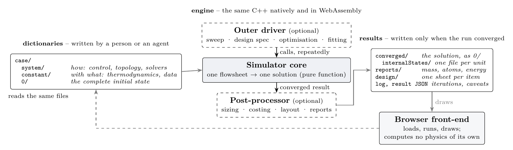

<!--
paper/joss/paper.md -- the Journal of Open Source Software submission for
Choupo (DEV.md 4c C126), adapted from the white paper
paper/whitepaper/whitepaper.tex.  Prose: CC BY-SA 4.0.

EVIDENCE.  Counts are read from generated files, never typed from memory:
generated/releaseInventory.json and generated/gateManifest.json at commit
aaccb336b (2026-10-21); generated/methodTools.json at ae796ee20.  Engine
claims follow the white paper, whose source carries a file:line, gate or
commit for each.  Re-read every number against the release this paper cites
before submission.

NAMING.  check_doctrine bans the names of other process simulators outside
its exempt trees; paper/whitepaper/ may name the one open reference
simulator, paper/joss/ may not (yet).  The State of the field therefore
describes that simulator without naming it; see the TODO there.

Build:  pandoc paper.md --citeproc --pdf-engine=pdflatex -o paper.pdf
(or the JOSS preview, the openjournals/inara image).
-->

# Summary

Choupo is an open-source chemical process simulator for teaching and for
research. It computes mass and energy balances, phase and chemical
equilibria, and the behaviour of unit operations -- flashes, reactors,
distillation columns, heat exchangers, crystallisers, dryers, membranes,
electrodialysis stacks -- alone or connected into plants with recycles. It
is written in C++17 with no external library and runs both natively and, compiled
to WebAssembly from the same source, in a web browser.

Choupo is a *glass-box* simulator, in a sense a user can check: the data a
calculation used and where each value came from, the hypotheses it rests
on, the equations it solves, the parameters it took and whether they lie
inside their evidence, the numerical method and every iteration, and the
results with their conservation balances are all readable in plain-text
files and in the run log. A case is a directory of text dictionaries in
which every dimensional value carries its unit. A word the engine does not
know, or an input that over-specifies a problem, is refused by name with
the remedy, rather than replaced by a default.

# Statement of need

A student of process simulation usually meets converged numbers. Whether a
missing interaction parameter was taken as zero, whether a vapour pressure
was evaluated outside its fitted range, whether a recycle converged or
merely stopped: none of this is on the screen. Choupo was written for the
reader who must see these things, because seeing them is the course. At its
default verbosity it prints each unit as it is solved, with its model, its
$K$-values and every Newton iteration, and it repeats at the end of the run
every extrapolation, estimate and default the run used.

The same transparency serves research in areas where breadth-first tools
carry little: nanofiltration and reverse osmosis, electrodialysis, aqueous
electrolyte chemistry, and detailed solids and bioprocess operations. A
researcher adds a transport law or a unit operation by writing one class
and one registration line, and the balances, reports and browser front-end
apply to it unchanged.

AI agents now prepare and run simulations from a sentence. Choupo keeps that
work open to inspection: an agent's case files are text a student reads, the
data it found carry source and licence, a fit it runs declares its acceptance
band before it runs, and the log shows what was computed and what was
assumed. The repository ships a short reference for agents (`AGENTS.md`,
`docs/ai/`). The target audience is undergraduate and graduate chemical
engineering, and researchers who need a calculation they can inspect.

# State of the field

Open-source tools cover parts of this space. Equation-oriented frameworks
such as IDAES [@lee2021] build process models for optimisation on an
algebraic modelling layer; property and kinetics libraries such as CoolProp
[@bell2014] and Cantera [@cantera] serve as components inside other
programs. Open-source flowsheet simulators with a graphical editor offer a
broad unit-operation and property catalogue in which the user builds the
case on a canvas.
<!-- TODO (authors): name and cite here the open-source (GPL-3.0) reference
simulator that the white paper (Section 6.4) compares with, once
check_doctrine admits paper/joss/ for that one name, as it does
paper/whitepaper/ (the one-line change is proposed in the C126 report).
Its bibliography entry is in paper/whitepaper/whitepaper.bib. -->

Choupo does not seek breadth parity. It differs in five design decisions.
(i) Every equation and iteration is visible, in source a student can read
and in the run log. (ii) The case is plain-text dictionaries on disk, on the
pattern of OpenFOAM [@weller1998]; the graphical interface is a viewer on
the ParaView pattern [@ahrens2005] -- OpenFOAM computes, ParaView shows -- that runs the
engine and draws what it published, computing no physics of its own.
(iii) An unknown word, an over-specified stream or an unauthorised
approximation is refused by name, never silently defaulted. (iv) Property
data are curated with provenance: each value cites its primary source and a
licence that permits redistribution, and a regressed parameter set enters
the catalogue only after a held-out test and human review. (v) Automated
checks, described below, hold conservation and provenance on the whole
tutorial corpus. Building a new program rather than contributing to an
existing one followed from (i)--(iii): they constrain the architecture from
the parser upwards. Choupo is an independent project, not affiliated with,
endorsed by or sponsored by OpenCFD Ltd or the OpenFOAM Foundation, and no
OpenFOAM source code was adapted or reused in it.

# Software design

A case is a directory: `system/` says how (control, flowsheet topology,
solver options, an optional outer driver and post-processing), `constant/`
says with what (the thermophysical system, reactions, local data), and `0/`
holds the complete initial state, one file per stream. Units are mandatory:
`P 1 bar;` and `F 100 kmol/h;` are converted to SI on reading, and a value
with the wrong dimensions is refused with both dimension sets printed. The
steady solution is written to `converged/` in the same layout as `0/`, only
when the run converged, with each unit's internal profile beside the
streams, so a converged directory renamed `0/` restarts the case.

The engine has three layers (\autoref{fig:architecture}): a simulator core
that maps one flowsheet to one solution as a pure function; an optional
outer driver (sweeps, design specifications, optimisation, parameter
estimation) that calls it repeatedly; and an optional post-processor chain
(sizing, costing, plant layout, reports). Five binaries partition the
problem classes -- steady state, batch campaigns, time-integrated plants,
the same with control loops, and a property bench -- while numerical
strategies coexist inside each and are chosen in the case: Newton and
Wegstein [@wegstein1958] on declared recycle tears, Nelder--Mead
[@nelder1965], Levenberg--Marquardt [@marquardt1963], Michelsen's stability
test [@michelsen1982], and explicit and Rosenbrock integrators. Every model
type is registered by one explicit line in a `registerBuiltins()` function,
with no self-registration macro, so the origin of every model is one
readable function. On a local installation a case may carry its own C++
unit operation or rate law, compiled against the engine through the same
mechanism.

{ width=100% }

The thermodynamics include NRTL [@renon1968], UNIFAC [@fredenslund1975],
COSMO-SAC [@lin2002; @bell2019], cubic [@soave1972; @peng1976] and PC-SAFT
[@gross2001] equations of state, aqueous electrolytes on Pitzer
[@pitzer1973] and related models with reactive speciation, and IAPWS-IF97
steam [@wagner2000]. Measured data are located in the ThermoML archive
[@frenkel2003]; a fitted pair is scored against an independent study and a
band declared before the fit, and the verdict may be negative. Every steady
run writes three balances by default: total mass, atoms per element, and
energy at the plant boundary. \autoref{fig:gui} shows the browser
front-end on a sectored plant.

{ width=100% }

# Research impact statement

Choupo is public under GPL-3.0-or-later at
<https://github.com/choupo-admin/choupo>, with the browser application at
<https://www.choupo.org>; the latest release is `Choupo-2608`. Today it
offers 5 binaries, 52 unit-operation models, a curated catalogue of 604
components and 276 mixture-parameter records, 482 runnable tutorial cases
(465 of them carrying a recorded reference answer), and 62 interactive
lessons in the browser across ten disciplines.

Some cases are anchored to independent published results: the
Williams--Otto reactor [@williams1960], the IAPWS-IF97 verification tables
[@wagner2000], the Hamer--Wu activity coefficients [@hamer1972], a measured
calcite pH [@plummer1982], and the Cavett recycle train on its primary
specification [@cavett1963]. On the research side, a
solution-diffusion-electromigration membrane law is held to the published
nanofiltration lines of @fdl2021 in the trace limit those lines
assume, and the predicted limiting current of an electrodialysis stack to
Table 4 of @geraldes2010, within +1 to +12 %. A comparison with an
open-source reference simulator on five of its published sample cases is
reported in the companion white paper and is being integrated into the
repository.

No classroom evaluation has been made and we claim no pedagogical effect;
no external publication has yet used Choupo. Its near-term significance is
as an inspectable teaching tool and as the platform for the authors'
membrane and electrodialysis research.

# AI usage disclosure

Generative AI was used in the software, its documentation and this paper.
The tool was Anthropic's Claude Code, an agentic coding assistant, running
models of the Claude Opus and Claude Fable families.
<!-- TODO (authors): JOSS asks for tool versions; add them at submission
(the repository's own rules keep exact model identifiers out of the tree). -->
Vítor Geraldes conceived and architected Choupo and directs its
development; substantial parts of the implementation, documentation and
tutorial corpus were produced with Claude Code's assistance -- code
generation and refactoring, test and verification-gate scaffolding,
documentation and tutorial drafting -- and this paper, like the white
paper it is adapted from, was drafted with it. Agents work under written
briefs on separate branches; architecture changes, pedagogical scope and a
recorded list of reserved decisions belong to Vítor Geraldes, and routine
technical steps inside an agreed scope are delegated and validated before
integration. The published project is human-curated, reviewed, corrected
and maintained by Vítor Geraldes and Pedro Mendes. The authors affirm that human team members reviewed,
modified and validated the AI-generated content and made the primary
architectural and design decisions.
<!-- TODO (authors): JOSS requires that humans "thoroughly reviewed,
modified, and validated ALL AI-generated content", and treats an
inaccurate disclosure as an ethical violation.  Confirm that this
sentence is accurate as written, or amend it to what is true, before
submission. -->

Correctness is not taken on trust from either authors or tools. Every
tutorial case is run by the test suite against its recorded reference
answer, with a guard against NaN and infinity; a pass means "not moved",
not "right", so a reference is re-recorded only after the moved rows are
listed with their reasons for human review. Conservation is checked by
gates that read the engine's own balance reports on every steady case;
plants that do not close are pinned by name with their measured residual,
and a pinned residual that grows or silently shrinks fails. Inputs the
engine cannot honour are refused by name. A named validation subset is
anchored to independent published results, recounted on every run. The
repository's 242 automated gates each print the claim they check. When an
error escapes, it becomes a new gate that rules out its class, verified by
sabotage: the defect is reintroduced and the gate is observed to fail. External benchmarks against an
open-source simulator complement these checks.

# Acknowledgements

Funding and institutional support: none to declare.
<!-- TODO (authors): confirm, or name any financial support. -->
*Choupo* is a registered trade mark of TalentGround Lda.; the trade mark is
not licensed by the software licence. The documentation is licensed under
CC BY-SA 4.0. OPENFOAM® is a registered trade mark of OpenCFD Limited,
producer and distributor of the OpenFOAM software via www.openfoam.com.
This offering is not approved or endorsed by OpenCFD Limited, producer and
distributor of the OpenFOAM software via www.openfoam.com, and owner of the
OPENFOAM® and OpenCFD® trade marks.

# References
